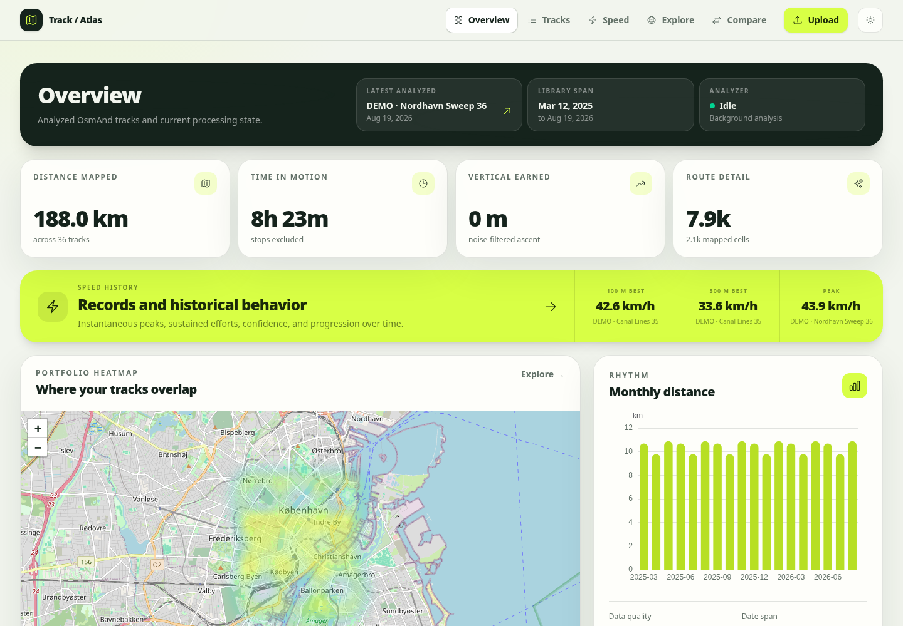
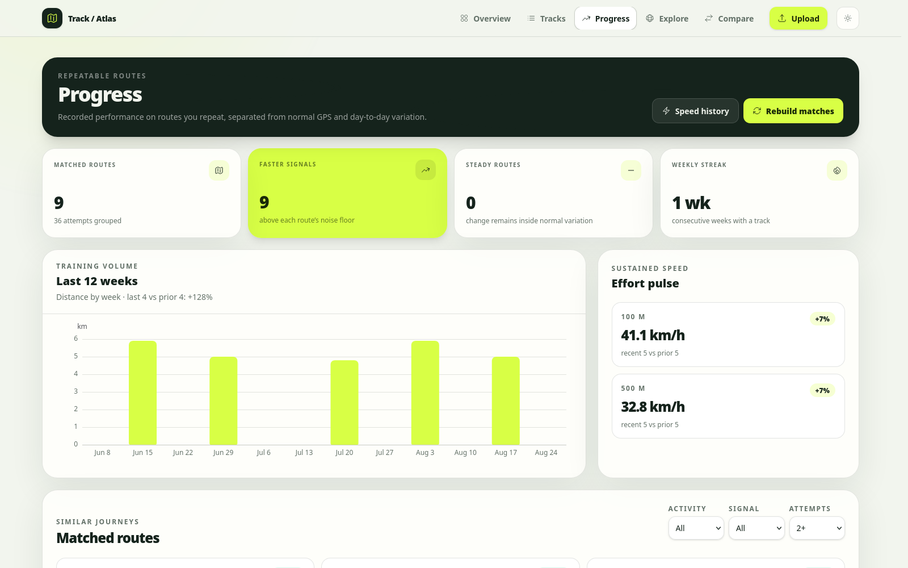
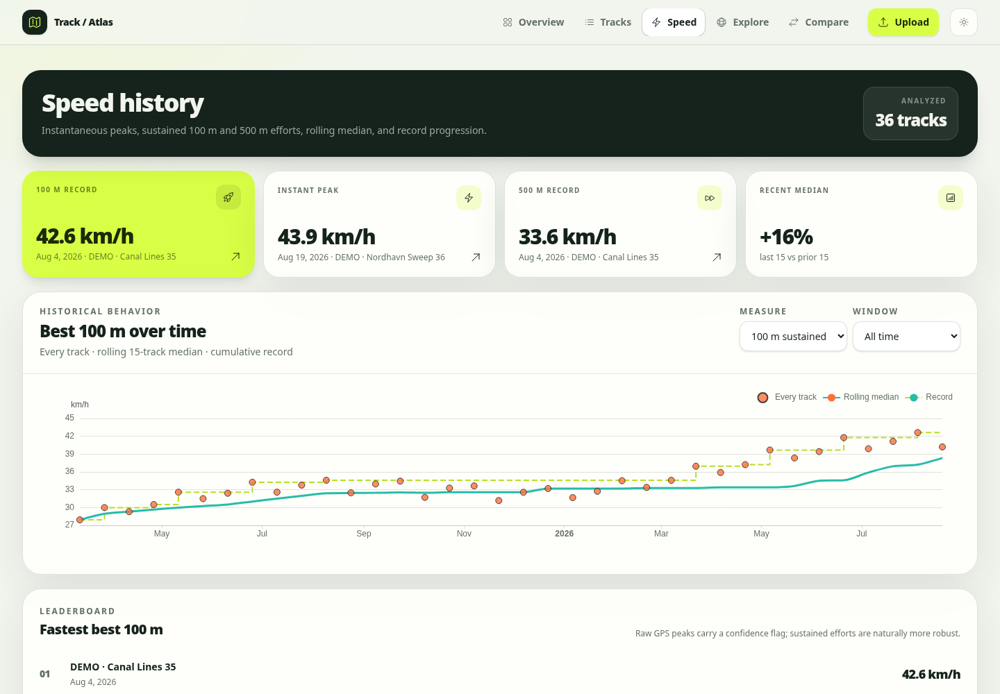
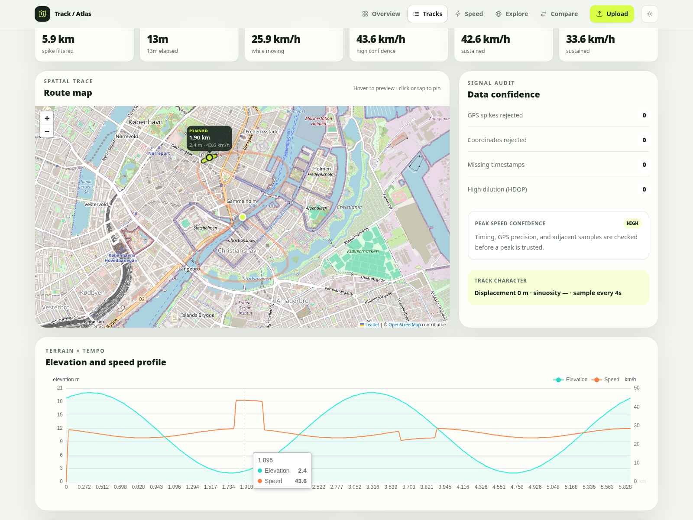
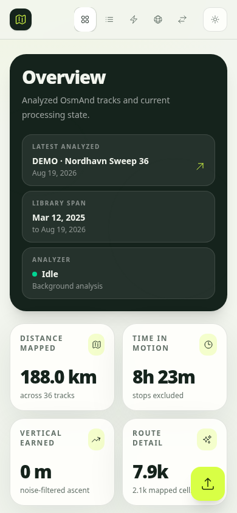
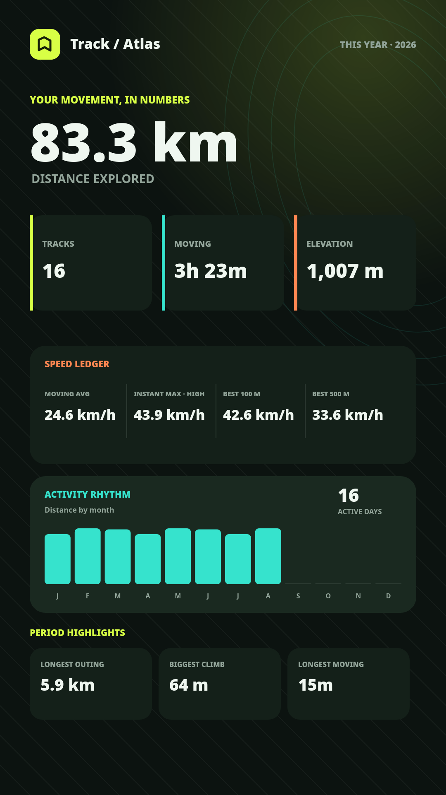
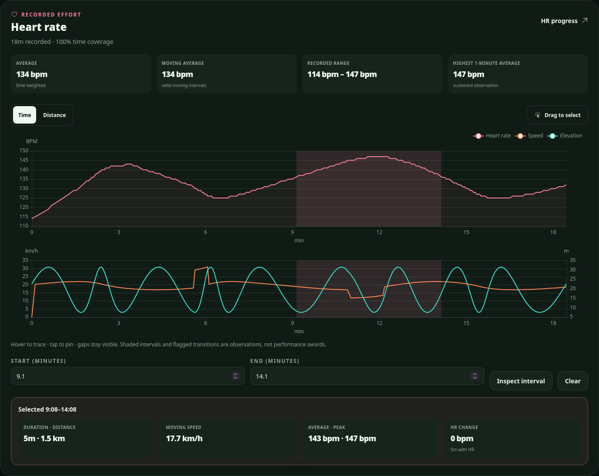

# Track / Atlas

Track / Atlas is a self-hosted application for turning an OsmAnd track library into useful maps, trends, records, and activity summaries. Upload an OsmAnd `.osf` export, single `.gpx` tracks, or `.fit` activities from a bike computer or app, and let the app validate, deduplicate, and analyze them in the background.





<table>
  <tr>
    <td width="50%"></td>
    <td width="50%"></td>
  </tr>
  <tr>
    <td align="center"><strong>Speed history</strong></td>
    <td align="center"><strong>Track detail</strong></td>
  </tr>
  <tr>
    <td width="50%" align="center"></td>
    <td width="50%" align="center"></td>
  </tr>
  <tr>
    <td align="center"><strong>Mobile overview</strong></td>
    <td align="center"><strong>Shareable recap</strong></td>
  </tr>
</table>

## What you can explore

- Distance, elapsed/moving/stopped time, average speed, and confidence-rated maximum speed
- Best sustained 1 km and 5 km speeds, personal records, and track-linked leaderboards
- Speed history with every-track scatter, rolling medians, cumulative records, and time filters
- Automatic matching of repeated routes, with faster/slower/steady signals that account for normal variation
- Route-specific speed history, latest-versus-prior comparisons, and synchronized 10-sector map analysis
- Twelve-week training volume, weekly streaks, and recent 1 km and 5 km effort trends
- Cadence and speed-sensor analysis: pedaling vs coasting, cadence by terrain, a gearing fingerprint, and device-vs-GPS distance with a wheel-calibration hint
- Detection of wrist sensors locking onto pedaling cadence: those readings are kept but left out of HR averages, maximum and zones
- Heart-rate timelines synchronized with the route map, interval selection, time distributions, and sustained 1/5/10/20-minute averages
- Same-route speed-versus-HR comparisons, cautious longer-term effort signals, and optional intensity bands with recorded-load history
- Elevation gain/loss, elevation range, sustained climbs, stopped periods, and kilometer splits
- Best 1 km, 5 km, 10 km, 20 km, and 40 km efforts
- Route shape, displacement, sinuosity, loop resemblance, sample cadence, and dominant bearing
- GPS quality checks for implausible spikes (over 80 km/h between fixes), pre-fix positions at the start of a recording, missing observations, invalid coordinates, and high HDOP. When a bike computer records a wheel sensor, its speed and odometer are used for distance, top speed and efforts instead of GPS
- Portfolio totals, monthly rhythm, coverage heatmaps, longest tracks, and four-track comparisons
- Story-sized PNG recaps for all time, the current year, month, or week

Maps and charts use compact precomputed renderings, so the interface stays responsive even with a large library.

Progress signals are deliberately factual rather than diagnostic. They describe changes in recorded performance on similar routes; traffic, stops, weather, equipment, and GPS quality can still affect the result.

## What you can upload

- **OsmAnd `.osf` exports**, which keep folder structure and are the best way to move a whole library.
- **Single `.gpx` tracks** from OsmAnd or any GPX 1.1 recorder. Garmin `TrackPointExtension` heart rate and cadence are read.
- **`.fit` activities** from bike computers, watches and phone apps, including cadence, device speed and distance, and heart rate.

Near-empty recordings (fewer than 10 points, under 200 m, or under a minute of movement) are kept but skipped: they do not count in totals, records or recaps, and the import log lists them with the reason.

The same file is stored once, however many times or batches it is uploaded in. A GPX and a FIT recording of the same ride are different files, so both are kept; they show up as two attempts of the same route.

## Getting tracks out of OsmAnd

On Android:

1. Open **Menu → Settings → Import/export → Export to file**.
2. Select **My Places → Tracks** and choose the folders or tracks you want.
3. Save or share the resulting `.osf` file to the device running Track / Atlas.

On iOS:

1. Open **Menu → Settings → Local backup → Back up as file**.
2. Select **My Places → Tracks** and choose the folders or tracks you want.
3. Save or share the resulting `.osf` file.

See the [OsmAnd import/export guide](https://www.osmand.net/docs/user/personal/import-export/) if the menu labels differ in your version.

## Install and run

You need Elixir 1.17 or newer, a compatible Erlang/OTP release, PostgreSQL, and Node.js/npm.

The development configuration expects PostgreSQL on `localhost` with username and password `postgres`. Adjust `config/dev.exs` if your local credentials differ.

```sh
mix setup
mix phx.server
```

Open [http://localhost:4000](http://localhost:4000), choose **Upload**, and select one or more `.osf`, `.gpx` or `.fit` files. A batch can contain up to 25 files, each as large as 5 GB.

Uploads and analysis continue in the background. You can leave the import screen after each browser upload reaches 100%; progress remains visible on Overview and Import.

Route matching is also asynchronous. It runs after track analysis settles, so importing a large library does not block the interface or rebuild route groups hundreds of times at once.

## Using the app

- **Overview** shows library totals, current processing, speed records, route coverage, and recent tracks.
- **Tracks** provides the searchable analyzed library and links to every track detail.
- **Progress** compares repeated routes, route sectors, weekly volume, and sustained-speed trends. Its **Heart rate** tab shows recorded effort and route-matched HR comparisons; **Speed history** opens the full maximum and sustained-speed record lab.
- **Explore** shows coverage, overlap, quality, and distance leaders.
- **Compare** places up to four tracks on the same normalized performance view.
- **Create recap** on Overview builds a 1080×1920 PNG for Instagram Stories or WhatsApp Status. Choose All time, This year, This month, or This week, then use the device share sheet or download the image.

Recaps are rendered in the browser and are not stored by Track / Atlas. They contain aggregate values only—no maps, route shapes, coordinates, track names, filenames, or exact activity times.

## Heart rate

Connect a heart-rate sensor to OsmAnd when recording, then import the usual OSF export. Tracks that contain HR automatically gain an effort profile; tracks without it keep their existing analysis.

On a track, hover over the HR or speed chart to trace the same position on the map. Click or tap to pin it. Switch between time and distance, drag to select an interval, or enter its start/end minutes. The selected section shows distance, speed, average/peak HR, and HR change. The sustained-HR cards open their original intervals. Higher HR is an observation, not a record to chase.

**Progress → Heart rate** shows weekly recorded time and comparisons on repeated routes in the same direction. Comparisons exclude warm-up, the first minute after stops, gaps, and suspect transitions. A longer-term signal needs six comparable attempts across at least 14 days. Wind, heat, fatigue, traffic, and sensor error can still explain differences.

No setup is needed for absolute BPM analysis. Optionally configure a known maximum HR or your own five intensity bands to see time in bands and rolling 7/28-day recorded load. Load is simply band minutes weighted 1–5; it is not TSS or a recovery recommendation. Missing HR remains unavailable, and changing bands recalculates past load in the background.

HR stays local and is not included in social recaps. See [how HR analysis works](docs/heart-rate.md) for the calculation rules and limitations.



## Cadence and speed sensors

Rides recorded with a cadence or speed sensor gain a **Pedaling & sensors** section on the track page:

- Cadence over time beside GPS and device speed, synchronized with the map like the HR chart.
- Average cadence (pedaling time only, and including coasting), coasting share, peak cadence and total pedal strokes.
- Time in 10 rpm bands, and cadence and coasting on descents, flat ground and climbs.
- A **gearing fingerprint**: metres travelled per pedal stroke. Each gear combination gives its own value, so the peaks show the gears you actually ride.
- **Device speed vs GPS**: distance difference, typical speed gap, and how much moving time the device covered while GPS was rejected. A steady offset suggests the wheel circumference on the device is wrong, and the page says by how much.

Device speed is whatever the recorder wrote: a wheel sensor when one is paired, otherwise its own GPS. FIT files do not reliably say which, so the app does not guess. Distances, speeds, splits and records everywhere else still use GPS positions. Device speed is used as a cross-check on GPS speed peaks: a peak the device did not see is rated low confidence.

**Progress → Pedaling** shows cadence and coasting over time, combined cadence bands and gearing across rides, terrain effects, and the device-vs-GPS distance trend.

FIT records without a GPS position (for example indoor rides) are skipped, because every view in the app is built on the route.

## Privacy and storage

Track analysis is local to this application. Source archives and extracted tracks live under `TRACK_STORAGE_PATH` (or `var/track_analyzer` in development) and are never served from `priv/static`.

The default Leaflet layer requests ordinary map tiles from OpenStreetMap. Change the map configuration in `config/config.exs` if you prefer a self-hosted tile server.

Track / Atlas currently has no built-in user accounts. Keep it on a trusted machine or private network, or place it behind authentication and HTTPS before exposing it publicly.

## Production configuration

The production runtime requires:

| Variable | Purpose |
| --- | --- |
| `DATABASE_URL` | PostgreSQL connection URL |
| `SECRET_KEY_BASE` | Phoenix signing/encryption secret; generate it with `mix phx.gen.secret` |
| `TRACK_STORAGE_PATH` | Durable writable storage for uploaded OSF, GPX and FIT files and extracted tracks |
| `PHX_HOST` | Public hostname; defaults to `example.com` |
| `PORT` | HTTP port; defaults to `4000` |

Back up both PostgreSQL and `TRACK_STORAGE_PATH`. The database contains analysis results, while the storage directory contains the source material needed for future reprocessing.

## Reanalyzing older tracks

When a newer analyzer version adds or changes persisted metrics, enqueue only outdated tracks:

```sh
mix track_analyzer.reanalyze --stale
```

Individual tracks can also be reanalyzed from their detail screen.

Progress shows an **Upgrade** action when older tracks need the newest analysis fields, and **Rebuild matches** is available whenever you want to refresh route grouping immediately.

## Development checks

```sh
mix precommit
mix assets.deploy
```

`mix precommit` compiles with warnings treated as errors, checks formatting, and runs the test suite.
